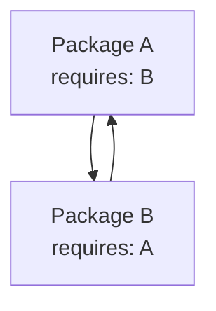
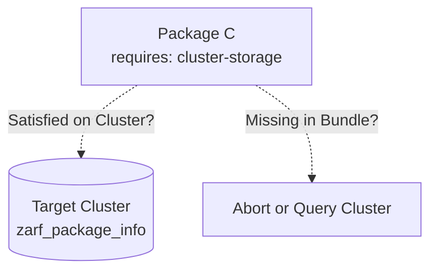
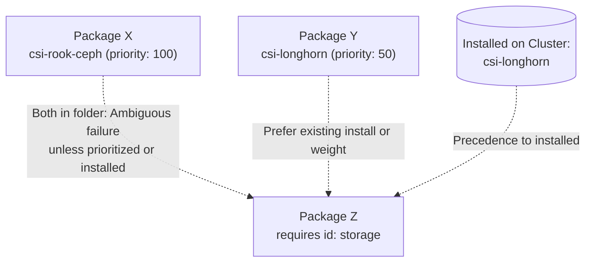
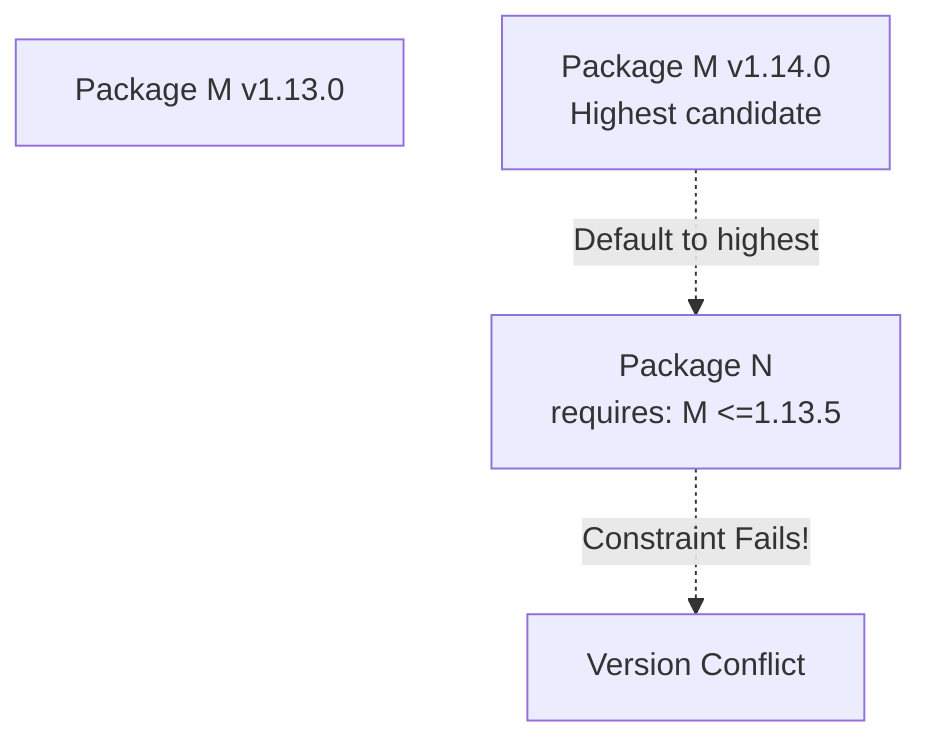
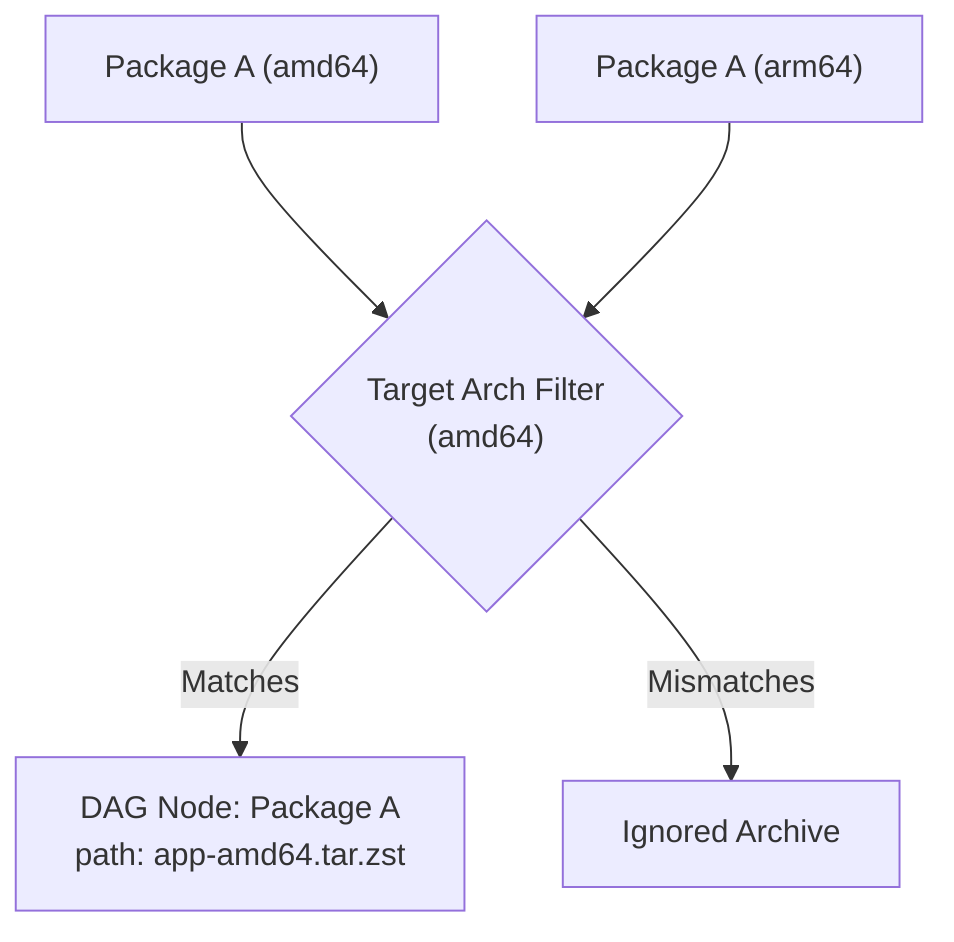
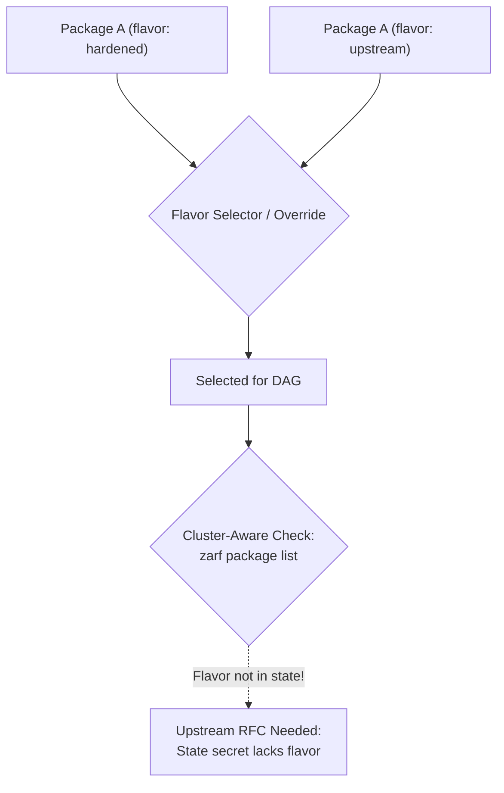
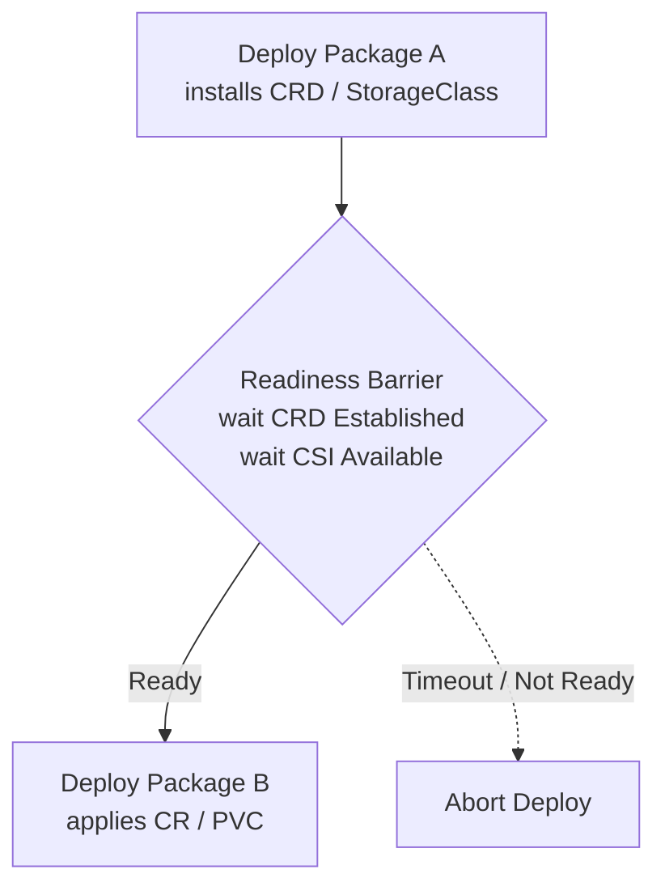
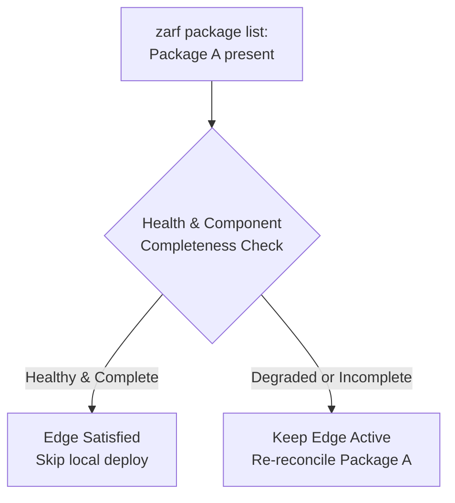
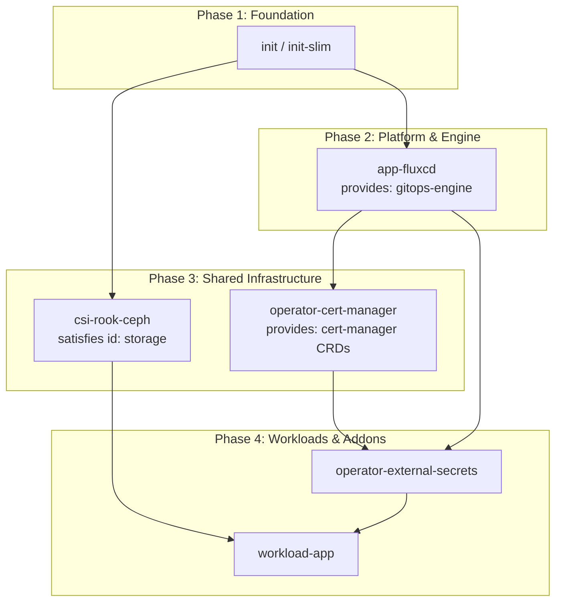

# Ordering a directory of Zarf packages into a deployment DAG from prerequisites

This document records the architectural decisions, constraints, and trade-offs for automatically ordering a directory of Zarf package archives into a Directed Acyclic Graph (DAG) for deployment, using each package's embedded prerequisites configuration.

## The problem and goal

Today, playbooks deploying stacks of Zarf packages (e.g. through `deploy_packages`) require authors to specify an explicit deployment list or numeric step prefix. When operators receive a directory of arbitrary Zarf package tarballs, manually sorting them requires unpacking or inspecting each package to deduce dependency order (e.g. init packages, CRDs, service meshes, storage, application workloads).

Because packages in this ecosystem carry `PackagePrerequisites` (`colonel-byte.dev/v1alpha1`) inside their embedded `documentation.prerequisites` mapping, a bundle planner can extract these documents without deploying anything, build a dependency graph, verify that the graph is acyclic, and emit a topological deployment order.

## Static inspection vs runtime deployment

The primary virtue of the `PackagePrerequisites` design is offline planning:
- `zarf package inspect documentation` extracts the embedded `docs/prerequisites.yaml` directly from the package archive without access to a Kubernetes cluster or network.
- `zarf_package_documentation` already implements non-destructive inspection and YAML decoding of documentation keys for single packages.
- A directory-level planner reads every archive in the target directory, extracts its prerequisites document (or handles packages without one), and constructs the dependency model entirely in memory before any cluster mutation occurs.

Inspecting many large archives introduces disk I/O and process overhead from running `zarf package inspect documentation` across tarballs. A realistic planner caches extracted documents by archive checksum/mtime to avoid redundant unpacking across runs.

## Dependency resolution mechanics

Each inspected package carries:
- Identity: `metadata.package` and `metadata.version` in `PackagePrerequisites` (mapping to the concrete archive path in the directory).
- Provides: `provides.capabilities`, `provides.crds`, `provides.namespaces`.
- Requires: `requires.packages` (with `name`, `names`, and optional group `id`), `requires.crds`, `requires.storage_classes`, and engine/controller requirements.

In a directory bundle, edges in the DAG are constructed primarily via package dependencies:

1. **Direct package edges (`requires.packages[].name`)**:
   If package $B$ requires package $A$ by name, directed edge $A \to B$ is added ($A$ must deploy before $B$). If a version constraint is declared, the bundle planner verifies whether $A$'s version in the directory satisfies $B$'s constraint.

2. **Alias edges (`requires.packages[].names`)**:
   If package $B$ allows `names: [init, init-slim]`, and the directory contains a package matching an alias (e.g. `init`), an edge is added from that package to $B$. If multiple satisfying packages are present in the directory, the planner flags the bundle as ambiguous unless disambiguated by explicit configuration.

3. **Alternative group edges (`requires.packages[].id`)**:
   When a consumer package declares alternative requirements sharing an `id` in `requires.packages` (e.g. `csi-rook-ceph` vs `csi-longhorn` grouped under `id: storage`), the requirement is a disjunction on the consumer side. If exactly one provider from that group exists in the directory, an edge is created from that provider to the consumer. If multiple candidate providers in the group are present in the directory, the planner refuses the ambiguity unless the operator explicitly selects the target provider.

4. **Transitive CRD and capability resolution**:
   Packages can also declare `requires.crds`. If package $A$ lists CRD $C$ in `provides.crds` and package $B$ lists $C$ in `requires.crds`, an implicit dependency edge $A \to B$ exists even if $B$ does not explicitly name $A$ in `requires.packages`.

## Edge cases and failure modes

- **Cycles**: If circular dependencies exist ($A \to B \to A$), topological sort fails. The planner reports the cycle trace clearly and aborts before deploying any package.

- **Phased component limits**: DAG planning at the archive level cannot resolve intra-package cyclic bootstrap sequences where the same package archive is deployed in multiple component phases (such as `init` seed components $\to$ storage provider $\to$ `init` full components, as recorded in `choice-deploy-packages-drift-scope.md`). Such bootstrap sequences remain the domain of explicit multi-phase playbooks.
- **Missing prerequisites**: If package $B$ requires a package or CRD not provided by any package in the directory, the planner distinguishes two modes:
  1. *Standalone bundle mode*: Reject the plan because the bundle is self-contained and incomplete.
  2. *Cluster-aware planning mode*: Check if the missing prerequisite is already satisfied on the target cluster (via `zarf_package_info` / `zarf_cluster_info`). If already satisfied on the cluster, the requirement is satisfied and does not need a local provider in the DAG.

- **Packages without prerequisites**: A package in the directory with no prerequisites document or an empty `requires` has in-degree 0 (no prerequisites) and out-degree 0 (unless another package requires it). Independent nodes are sorted deterministically using lexical package name ordering as a tie-breaker.
- **Multiple packages in the same `id` group**: When a directory contains multiple provider archives that satisfy the same consumer `id` group (e.g. both `csi-rook-ceph` and `csi-longhorn` for `id: storage`):
  1. *Default fail-fast rule*: The planner refuses the plan and errors out immediately. Attempting to deploy both mutually exclusive providers, or arbitrarily picking one without operator intent, risks conflicting storage classes or incorrect infrastructure.
  2. *Cluster precedence (existing installation preference)*: If one candidate from the group is already deployed on the cluster (e.g. `csi-longhorn` is already installed and healthy), cluster-aware mode prefers the existing installation. The requirement is satisfied by the cluster, avoiding an unnecessary redeployment or duplicate provider rollout.
  3. *Priority / weight ranking*: If offline bundles must choose between multiple candidate providers without operator intervention, package requirements or inventory configuration can declare an explicit weight or priority (e.g. `priority: 100` on `rook-ceph` vs `priority: 50` on `longhorn`). In the absence of an explicit priority or existing cluster deployment, equal-priority candidates remain a hard ambiguity failure.

- **Multiple versions of the same package**: When the directory holds multiple versions of a single package (e.g. `operator-cert-manager` v1.13.0 and v1.14.0):
  1. *Default selection*: The planner selects the highest version present.
  2. *Constraint conflict risk*: If a dependent package requires a specific or constrained lower version (e.g. `<=1.13.5`), selecting the highest available version (v1.14.0) causes the version check to fail.
  3. *Planner resolution options*: The planner can evaluate version constraints against available candidate archives before picking the latest version that satisfies all consumers' constraints, or fail fast and require the operator to prune superseded archives from the directory.

- **Multiple architectures in the bundle directory**: Air-gapped delivery directories often stage archives for multiple CPU architectures side-by-side (e.g. `zarf-package-app-amd64-v1.0.0.tar.zst` and `zarf-package-app-arm64-v1.0.0.tar.zst`). Keying graph nodes strictly by package identity creates duplicate node collisions unless architecture is pruned first.
  1. *Architecture disambiguation*: The planner filters candidate archives by target architecture before building vertices. In cluster-aware mode, the architecture is queried from the cluster nodes (`kubernetes.io/arch`); in offline mode, it is provided explicitly (defaulting to the delegate host architecture).

- **Package flavors and variant selection**: Packages can be built under distinct flavors (e.g. `flavor: upstream` vs `flavor: hardened` or vendor-specific variants). Unlike architecture, flavor selection may be an intentional deployment requirement for a cluster stack.
  1. *Bundle ambiguity*: When multiple flavors of the same package and version exist in the folder, the planner requires an explicit flavor selector; otherwise, it fails fast on ambiguity.
  2. *Upstream Zarf state limitation & RFC*: Today, Zarf's cluster state secret (`zarf package list`) does not record or report the deployed package flavor. A cluster-aware planner cannot determine which flavor is currently running on the cluster. Recording and exposing deployed flavor data requires an upstream Zarf RFC (ZEP) to include build flavor in deployed package state. Until upstream tracks flavor on-cluster, cluster-aware checks cannot assert flavor parity without external package inspection.

- **Asynchronous CRD and StorageClass readiness races**: While Zarf deploys package archives sequentially, Kubernetes registers CRDs and CSI storage drivers asynchronously. If package $A$ installs a CRD or CSI driver and package $B$ immediately creates Custom Resources or PersistentVolumeClaims, the Kubernetes API server may reject $B$'s manifests with webhook timeouts or missing resource errors.
  1. *Topological ordering vs readiness barrier*: The DAG planner establishes deployment order ($A \to B$), but execution must enforce a readiness barrier between dependent steps (e.g. awaiting CRD `Established` condition or CSI controller availability) before initiating $B$'s deployment.

- **Partial or unhealthy cluster state**: In cluster-aware planning mode, a package may appear in `zarf package list`, but a previous deployment failed midway or omitted required components.
  1. *Health and component completeness check*: Rather than assuming package presence in `zarf package list` satisfies an edge, cluster-aware planning must verify that required components are deployed and controller workloads meet availability constraints (`minAvailable >= 1`). If unhealthy or incomplete, the edge must remain active in the local deployment DAG to re-reconcile the package.

- **Directory hygiene and non-archive artifacts**: Staging directories frequently hold non-package artifacts (`.sha256` checksums, `.sig` Cosign signatures, `README.md`, or unrelated files). Furthermore, Zarf packages already embed internal checksums and metadata specifications.
  1. *Archive filtering*: The planner must strictly filter for valid archive extensions (`*.tar.zst`, `*.tar`) and ignore non-tarball companion files.
  2. *Graceful warning on non-Zarf tarballs*: When an archive in the directory cannot be parsed by Zarf (e.g. an arbitrary tarball missing `zarf.yaml` or failing internal checksum validation), the planner warns or ignores the file rather than aborting the entire bundle plan.

## Output shape and execution contract

The DAG planner emits a linear, topologically ordered list of package items compatible with `deploy_packages` (`zarf_packages_to_deploy`), mapping each resolved node to its concrete archive path.

Because Zarf mutates cluster state sequentially through a single kubeconfig and Ansible tasks are serialized with `run_once: true` on the delegated host, execution against the cluster is serialized in topological order rather than run concurrently.

## Visualizing the dependency graph

