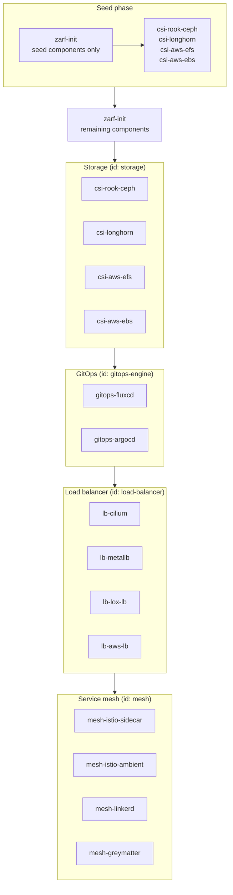

# The phased bundle the DAG has to produce

Each box is an alternative group: the bundle carries several providers and the plan picks one, which is `requires.packages[].id` on the consumer side. The arrows are the phase order a topological sort must recover from the documents alone.

Two things on the whiteboard that the planner cannot do today, both already recorded in `docs/agent/choice-prerequisites-package-dag.md`:

- The seed phase deploys the **same** `zarf-init` archive twice, with different components, around the storage provider. A graph keyed by package identity has one node for it, so this bootstrap stays an explicit two-item stack.
- Every box is a pick-one group, so a directory holding all four CSI archives is ambiguous by default and needs an operator selection.
